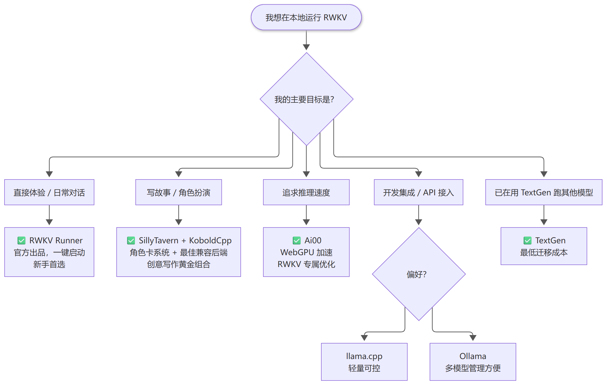

import { CardContainer } from 'components-docs/card/card-container.tsx'
import { Card } from 'components-docs/card/card.tsx'
import { CallOut } from 'components-docs/call-out/call-out.tsx'
import { SingleCard } from 'components-docs/hero-card/single-card.tsx'
import { MultiCard } from 'components-docs/hero-card/muti-card.tsx'
import { HeroCardContainer } from 'components-docs/hero-card/hero-card-container.tsx'
import TutorialsDial from 'components-docs/hero-card/icons/tutorials/dial.tsx'
import TutorialsCloudDownload from 'components-docs/hero-card/icons/tutorials/cloud-download.tsx'
import TutorialsFlame from 'components-docs/hero-card/icons/tutorials/flame.tsx'
import TutorialsMagicWandSparkle from 'components-docs/hero-card/icons/tutorials/magic-wand-sparkle.tsx'
import TutorialsButton from 'components-docs/hero-card/icons/tutorials/button.tsx'
import TutorialsClipboard from 'components-docs/hero-card/icons/tutorials/clipboard.tsx'
import TutorialsEye from 'components-docs/hero-card/icons/tutorials/eye.tsx'
import TutorialsHammer from 'components-docs/hero-card/icons/tutorials/hammer.tsx'
import TutorialsPaperPlane from 'components-docs/hero-card/icons/tutorials/paper-plane.tsx'
import TutorialsBookOpen from 'components-docs/hero-card/icons/tutorials/book-open.tsx'

RWKV 教程系列提供 RWKV 从入门（体验在线 demo）到精通（本地部署、微调、预训练）的全教程。

## RWKV 入门教程

<CallOut type='info'>
入门教程主要介绍 RWKV **模型的种类和下载方法**、**在线体验方法**，以及**如何改善 RWKV 模型的生成质量**。
</CallOut>

### 在线体验和模型下载

<HeroCardContainer>
<SingleCard className="col-span-1" IconImage={TutorialsPaperPlane} title="在线体验 RWKV 模型" description="通过在线 Demo 体验各种 RWKV 模型" themeColor="green" href="/tutorials/basic/How-To-Play" />
<SingleCard className="col-span-1" IconImage={TutorialsCloudDownload} title="下载 RWKV 模型" description="了解 RWKV 的模型种类和下载方法" themeColor="indigo" href="/tutorials/basic/Model-Download" />
</HeroCardContainer>

### 改善 RWKV 模型的生成质量

<HeroCardContainer>
<SingleCard className="col-span-1" IconImage={TutorialsDial} title="调整 RWKV 的解码参数" description="调整 RWKV 模型的解码参数，直接影响模型的生成效果" themeColor="orange" href="/tutorials/basic/RWKV-Parameters" />
<SingleCard className="col-span-1" IconImage={TutorialsEye} title="RWKV 的提示词格式" description="通过使用 RWKV 偏好的提示词格式，可以改善模型的输出质量" themeColor="orange" href="/tutorials/basic/Prompt-Format" />
</HeroCardContainer>

## RWKV 中级教程

先查看[本地运行方案选择](/tutorials/intermediate)，根据使用目标选择工具，再进入对应教程。

### 日常对话与图形界面

希望通过图形界面加载模型、开始聊天，可以从以下工具选择。

- [RWKV Runner 使用教程](/tutorials/intermediate/RWKV-Runner/Introduction)
- [Ai00 使用教程](/tutorials/intermediate/ai00/Introduction)
- [TextGen 推理教程](/tutorials/intermediate/RWKV-Inference/text-generation-webui)

### 写作与角色扮演

先用 KoboldCpp 运行模型，再按需连接 SillyTavern 使用角色卡和聊天功能。

- [KoboldCpp 推理教程](/tutorials/intermediate/RWKV-Inference/KoboldCpp)
- [SillyTavern 角色扮演教程](/tutorials/intermediate/RWKV-Inference/SillyTavern)

### 命令行与模型服务

需要命令行控制、模型管理或 API 接入时，可以选择 llama.cpp 或 Ollama。

- [llama.cpp 推理教程](/tutorials/intermediate/llamacpp)
- [Ollama 推理教程](/tutorials/intermediate/RWKV-Inference/Ollama)

### Python 开发与高并发推理

需要在代码中调用模型、进行算子实验或配置高并发服务时，参考以下教程。

- [RWKVpip 指南](/tutorials/intermediate/RWKVpip)
- [rwkv_lightning_cuda 教程](/tutorials/intermediate/rwkv_lightning)
- [RWKV-FLA 使用教程](/tutorials/intermediate/RWKV-FLA)
- [Albatross](https://github.com/BlinkDL/Albatross)

---

## RWKV 高级教程

<CallOut type='info'>
高级教程包含 RWKV 模型的**预训练和微调方法**。
</CallOut>

### 微调简介和准备工作

<HeroCardContainer>
<MultiCard 
    className="col-span-1 lg:col-span-2" 
    IconImage={TutorialsClipboard} 
    title="微调简介和准备工作" 
    description="为什么要微调 RWKV 模型？微调之前需要准备什么？" 
    themeColor="orange" 
    buttons={[
        {label: "微调简介", href: "/tutorials/advanced/Fine-Tune/Introduction"},
        {label: "配置训练环境", href: "/tutorials/advanced/Fine-Tune/FT-Environment"},
        {label: "准备训练数据", href: "/tutorials/advanced/Fine-Tune/FT-Dataset"},
    ]}
/>
</HeroCardContainer>

### 训练方法的详细教程

<HeroCardContainer>
<MultiCard 
    className="col-span-1 lg:col-span-2" 
    IconImage={TutorialsBookOpen} 
    title="训练方法的详细教程" 
    description="介绍 RWKV 模型的预训练、State Tuning、LoRA、Miss 等微调方法的详细教程" 
    themeColor="purple" 
    buttons={[
        {label: "RWKV 预训练教程", href: "/tutorials/advanced/pretrain"},
        {label: "State Tuning 微调", href: "/tutorials/advanced/Fine-Tune/RWKV-PEFT/State-Tuning"},
        {label: "LoRA 微调", href: "/tutorials/advanced/Fine-Tune/RWKV-PEFT/LoRA"},
        {label: "MiSS 微调", href: "/tutorials/advanced/Fine-Tune/RWKV-PEFT/MiSS"},
    ]}
/>
</HeroCardContainer>

**预训练教程**基于社区维护的 [RWKV-LM-V7](https://github.com/RWKV-Vibe/RWKV-LM-V7)，官方参考实现请查看 [RWKV-LM 的 `RWKV-v7/train_temp`](https://github.com/BlinkDL/RWKV-LM/tree/main/RWKV-v7/train_temp)。

RWKV 官方微调仓库 [RWKV-PEFT](https://github.com/Joluck/RWKV-PEFT)，包含常见的 `LoRA` 微调，也有 RWKV 模型特有的 `State-Tuning` 和 RWKV 社区成员 [@Joluck](https://github.com/Joluck) 开发的 `MiSS` 微调方法。
