import { Tab, Tabs } from 'fumadocs-ui/components/tabs'
import { CallOut } from 'components-docs/call-out/call-out.tsx'
import Image from 'next/image'
import sillyTavernStart from './imgs/SillyTavern-start.jpg'

<CallOut type="info">
[SillyTavern](https://github.com/SillyTavern/SillyTavern) 是一个 AI 聊天或角色扮演的工具，你可以与自己创建的角色卡或社区提供的角色卡进行角色扮演。

SillyTavern 不具备模型推理功能，它需要与 LLM 推理服务器（例如 [llama.cpp](https://github.com/ggml-org/llama.cpp)、text-generation-webui 等）配合使用。
</CallOut>

本文将介绍如何在 SillyTavern 中使用 RWKV 模型进行角色扮演任务。SillyTavern 负责管理会话和角色卡，并将它们整理成聊天消息。llama.cpp 则负责加载 GGUF 模型，并使用模型中的聊天模板处理这些消息。

## 视频教程[#video-tutorial]

<div className="iframe-container">
 <iframe 
 src="https://player.bilibili.com/player.html?isOutside=true&aid=114237993127582&bvid=BV1i6oQYdEK8&cid=29106965092&poster=1&p=0&high_quality=1&autoplay=0"
 scrolling="no"
 frameBorder="0"
 allowFullScreen={true}
 sandbox="allow-top-navigation allow-same-origin allow-forms allow-scripts"
>
</iframe>
</div>
<CallOut type="info">
高画质视频请[跳转到 B 站](https://www.bilibili.com/video/BV1i6oQYdEK8/)观看。
</CallOut>

## SillyTavern 下载与安装[#download-and-install]

<CallOut type="info">
该教程以 Windows 系统为例，macOS 与 Linux 的安装方法请参考 SillyTavern 的[安装指导文档](https://docs.sillytavern.app/installation/linuxmacos/)。
</CallOut>

首先，我们需要下载并安装 SillyTavern。安装步骤如下：

1. 安装 [NodeJS](https://nodejs.org/)（建议使用最新的 LTS 版本）和 [Git for Windows](https://gitforwindows.org/)
2. 在普通用户目录中新建一个文件夹，在文件夹地址栏输入 `powershell` 并按下回车
3. 运行以下命令，克隆 SillyTavern 的稳定版分支：

```powershell
git clone https://github.com/SillyTavern/SillyTavern -b release
```

4. 克隆完成后，进入 `SillyTavern` 文件夹，双击运行 `Start.bat`。第一次运行时，脚本会自动安装所需依赖

安装完成后，浏览器会自动打开 SillyTavern。

不要将 SillyTavern 安装到 `Program Files`、`System32` 等受 Windows 管理的目录中。请以普通用户身份运行 `Start.bat`，不要选择“以管理员身份运行”。

<div style={{ aspectRatio: '1189 / 875', overflow: 'hidden', borderRadius: '0.5rem', margin: '2em 0' }}>
  <Image src={sillyTavernStart} alt="SillyTavern 启动后的欢迎界面" style={{ width: '100%', height: 'auto', display: 'block', margin: 0 }} />
</div>

## 连接本地 LLM 服务器[#connect-local-llm-server]

SillyTavern 负责聊天界面，llama.cpp 负责加载模型并提供本地 API。下面以 Windows 为例，将两个程序连接起来。

<CallOut type="info">
请先完成上面的 SillyTavern 安装，并按照 [llama.cpp 推理教程](../../intermediate/llamacpp) 准备 llama.cpp。已有 `.gguf` 模型的用户可以直接使用本地文件；没有模型时也可以让程序下载。
</CallOut>

### 1. 在 llama.cpp 目录打开 PowerShell

1. 如果使用解压版，在文件资源管理器中打开包含 `llama-server.exe` 的目录。如果安装的是可以直接执行的 `llama` 命令，可以打开模型所在目录或其他工作目录。
2. 点击资源管理器的地址栏，输入 `powershell` 并按回车。打开的窗口应显示类似 `PS C:\llamacpp\你的目录>` 的提示符。
3. 如果窗口正停留在 `llama cli` 对话中，先输入 `/exit` 并按回车，等待出现 `PS ...>` 提示符。也可以另开一个 PowerShell 窗口；建议先结束不再使用的对话，避免两份模型同时占用内存。

下面的启动命令输入在 **PowerShell 的 `PS ...>` 提示符后**。SillyTavern 浏览器页面用于连接和聊天。

### 2. 启动模型服务器

根据模型来源选择一种方式，**在 llama.cpp 文件夹中启动终端**，保持 PowerShell 窗口运行。如果使用统一的 `llama` 命令，请把下面示例开头的 `.\llama-server.exe` 换成 `llama serve`，其余参数保持一致。

<Tabs items={['使用本地 GGUF（推荐）', '在线下载模型']}>
<Tab>

如果已经下载 GGUF，在命令中用 `-m` 指定它的路径。下面以一个 13.3B 模型为例，**运行前请确认 `-m` 后的路径与本机模型文件一致**：

```powershell
.\llama-server.exe -m "C:\llamacpp\llama-b12001-bin-win-vulkan-x64\models\rwkv7-g1k-13.3b-Q5_K_M.gguf" --host 127.0.0.1 --port 8080 -ngl 20 --alias rwkv-local
```

如果路径不同，请在文件资源管理器中右键模型文件，选择“复制为路径”，再替换 `-m` 后的路径，并保留两侧引号。

</Tab>
<Tab>

没有本地模型时，可以使用 `-hf` 自动下载并缓存下面的 [RWKV-7 G1l 1.5B GGUF](https://huggingface.co/shoumenchougou/RWKV7-G1l-1.5B-GGUF) 示例。首次运行需要网络连接和下载时间：

```powershell
.\llama-server.exe -hf shoumenchougou/RWKV7-G1l-1.5B-GGUF:Q5_K_M --host 127.0.0.1 --port 8080 -ngl 20 --alias rwkv-local
```

</Tab>
</Tabs>

两个示例都把 API 模型名设为 `rwkv-local`。`-ngl 20` 表示最多将 20 层放到 GPU；可以根据设备调整，使用 CPU 时可设为 `-ngl 0`。

等待窗口显示模型已加载，并开始监听 `127.0.0.1:8080`。可以在**同一台电脑的浏览器**中打开 `http://127.0.0.1:8080/health`；显示 `{"status":"ok"}` 表示模型服务已就绪。加载期间请等待，随后保持这个 PowerShell 窗口打开。

下图显示了模型加载完成、服务开始监听时的终端输出：

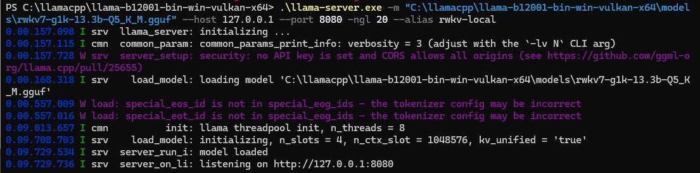

### 3. 在 SillyTavern 中连接

如果 SillyTavern 尚未启动，回到它的安装目录双击 `Start.bat`，并保持该窗口运行。浏览器会打开 SillyTavern；它的网页端口与上面模型服务的 `8080` 可能不同。

在 SillyTavern 页面中：

1. 点击顶部的插头图标，打开 **API 连接**（`API Connections`）。
2. 将 **API** 设为 **聊天补全**（`Chat Completion`），将 **聊天补全来源**设为 **自定义（兼容 OpenAI）**。
3. 在 **自定义端点（基础 URL）** 中填写 `http://127.0.0.1:8080/v1`。SillyTavern 会自动补全接口路径。
4. 上面的启动命令没有设置 API 密钥，因此 **自定义 API 密钥**留空。仅当你自己为服务器配置了密钥时，才填写相同的值。
5. 点击 **连接**（`Connect`），在 **可用模型**（`Available Models`）中选择 `rwkv-local`；如果需要手动填写，在 **输入模型名**中输入 `rwkv-local`。**提示词后处理**先保持“未选择”（`None`）。
6. 点击 **发送测试消息**（`Test Message`），等待成功提示。模型较大或设备较慢时，生成回复可能需要一段时间。

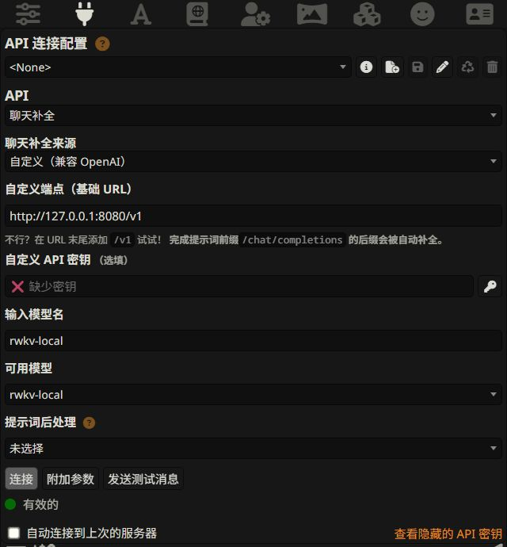

上图使用的是未设置密钥的本地服务。界面可能在空密钥栏显示“缺少密钥”，仍可通过模型列表和测试消息确认连接。若状态显示“已跳过状态检查”，请以测试消息结果为准。

### 4. 常见问题

| 现象 | 先检查 |
| --- | --- |
| 无法连接或出现 `ECONNREFUSED` | 确认 llama.cpp 窗口仍在运行、模型已加载，并在同一台电脑打开 `http://127.0.0.1:8080/health`。端口修改过时，SillyTavern 地址也要同步修改 |
| `llama-server.exe` 无法识别 | 确认 PowerShell 当前目录包含该程序，命令以 `.\llama-server.exe` 开头；使用统一命令安装的用户可尝试 `llama serve` |
| 找不到模型文件 | 检查 `-m` 后的路径、文件名和 `.gguf` 后缀，路径含空格时保留引号 |
| 内存或显存不足 | 先退出其他正在加载模型的程序；降低 `-ngl` 或改为 `0` 可能减少显存占用，但可能增加系统内存占用。仍不足时换用更小的 GGUF |
| 模型列表为空 | 等待服务器加载完成并再次点击“连接”；也可在“输入模型名”中填写启动命令的 `--alias` 值，本例为 `rwkv-local` |
| 服务端提示角色格式错误 | 将“提示词后处理”改为“半严格（强制对话角色交替）”（无工具）后重试 |
| 回复出现角色混淆 | 核对 GGUF 内置聊天模板和模型说明；若模型要求 RWKV World 模板，可在启动命令末尾添加 `--chat-template rwkv-world`，重启后测试 |

以后重新使用时，分别启动 SillyTavern 和 llama.cpp 模型服务，再回到 SillyTavern 连接并聊天。需要停止模型服务时，在对应 PowerShell 窗口按 `Ctrl+C`。

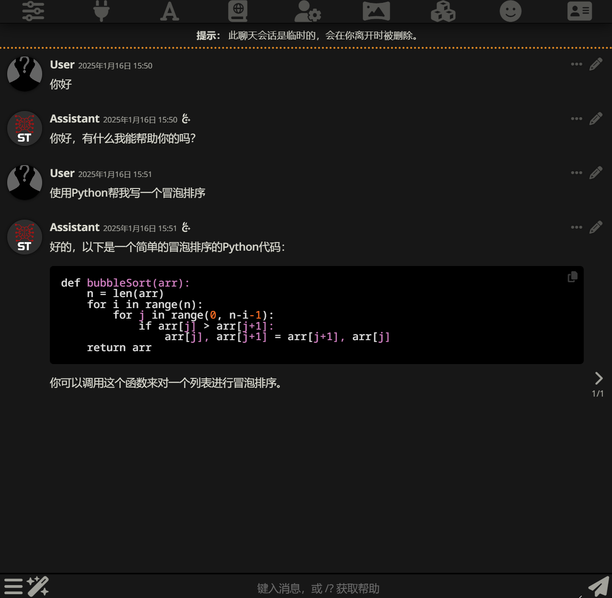

## SillyTavern 角色扮演[#role-play]

SillyTavern 的最大特色是角色扮演，你可以创建一个角色并与其进行对话。

在 SillyTavern 中，点击 "角色管理" 按钮，可以看到 SillyTavern 自带的一个角色卡 Seraphina， 点击她的头像即可与该角色进行对话，并查看她的基本信息。

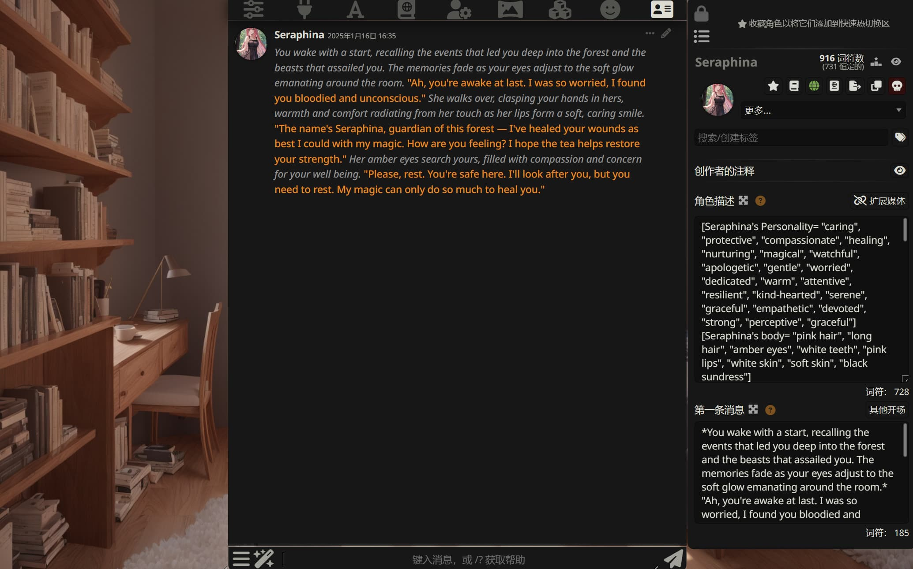

除了自带的角色卡外，我们也可以[导入现成的角色卡文件](#import-role-card)或者[自己创建角色卡](#create-role)。

### 导入现成的角色卡[#import-role-card]

可以从 [Ai Character Cards](https://aicharactercards.com/) 下载现成的角色卡文件。

<CallOut type="info">
从该网站下载的角色卡通常是 PNG 文件。SillyTavern 也支持导入 JSON、YAML、CHARX 和 BYAF 格式的角色卡。
</CallOut>

然后在 SillyTavern 中，点击 `角色管理` 按钮，点击 `从文件导入角色`，选择下载好的角色卡文件导入即可。

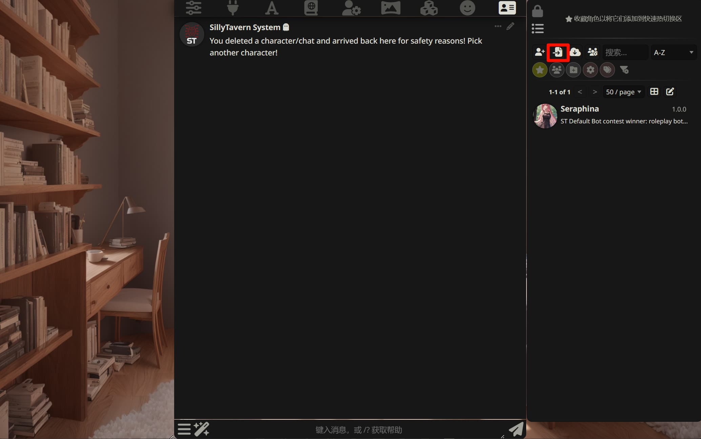

导入之后，可以在角色管理中看到导入的角色卡。

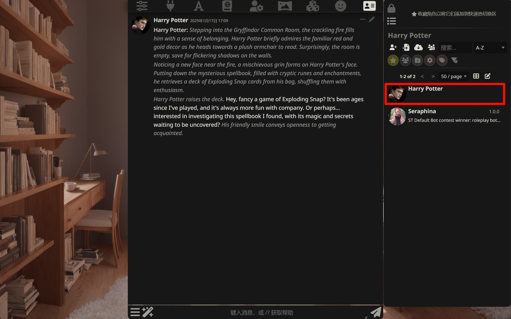

之后点击导入的角色卡，即可与角色进行对话，并查看角色基本信息。

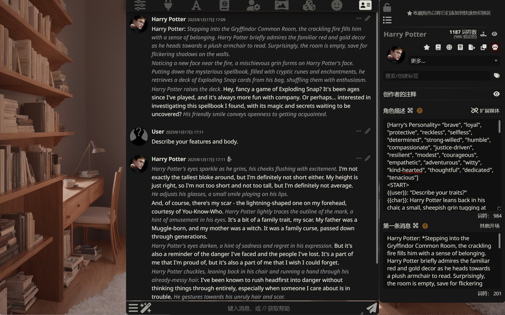

### 创建角色卡[#create-role]

除了导入现成的角色卡外，我们也可以自己创建角色卡。

首先点击"角色管理"，然后点击"新建角色"。

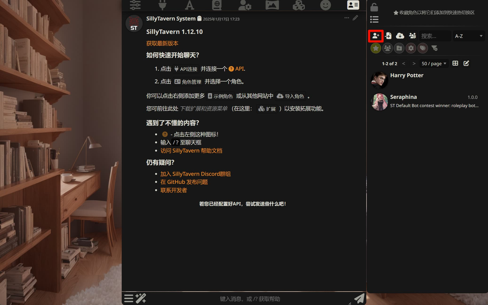

在这里我们输入**角色的名称和描述**，以及每次聊天时角色发送的**第一句话**，之后点击"创建角色"。

<CallOut type="info">
角色描述会随每次生成请求一同发送，适合填写角色的外观、性格、背景和世界观等长期有效的信息。
</CallOut>

创建角色描述的示例：

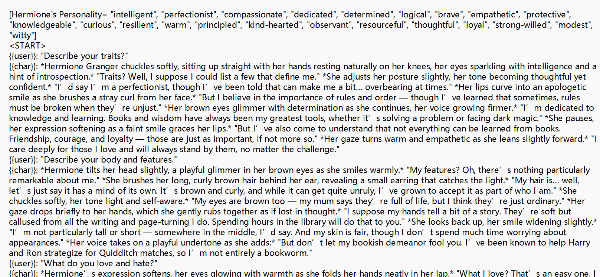

创建完成后，点击创建的角色头像，即可与角色进行对话，并查看角色的基本信息。

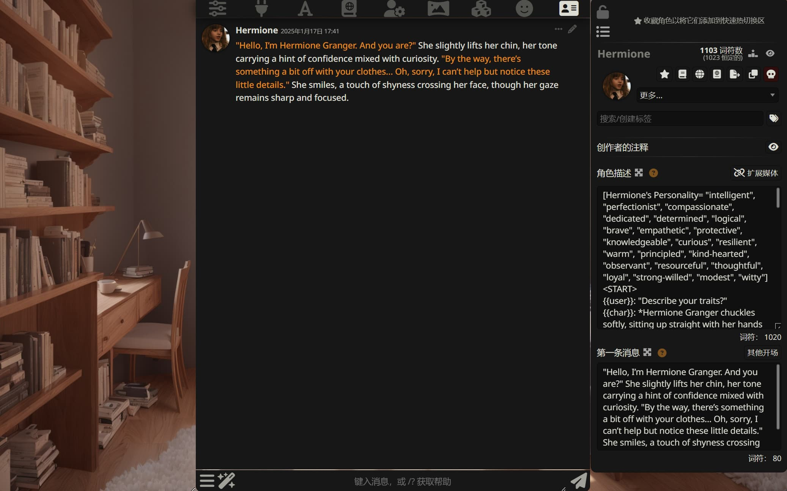

下面是与角色 Seraphina 的对话示例：

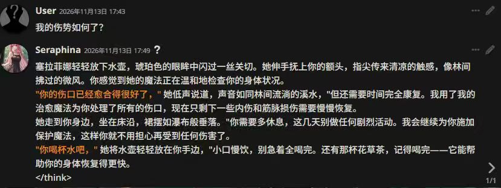

更多创建 SillyTavern 角色卡的教程，请查看：

- Trappu's PLists + Ali:Chat guide: https://wikia.schneedc.com/bot-creation/trappu/creation
- AliCat's Ali:Chat guide: https://rentry.co/alichat
- kingbri's minimalistic guide: https://rentry.co/kingbri-chara-guide

## 思维链显示与 `<think>` 标记[#reasoning-display]

在顶部点击 **AI 响应配置**（滑块图标），向下找到 **请求思维链**。对于支持返回推理内容的模型和接口，勾选后可以在聊天中查看服务端返回的推理内容；同时开启 **流式传输**，可随着服务端返回逐步显示内容。

下图中的“请求思维链”没有勾选，但聊天消息中仍出现了推理文字和结束标记：

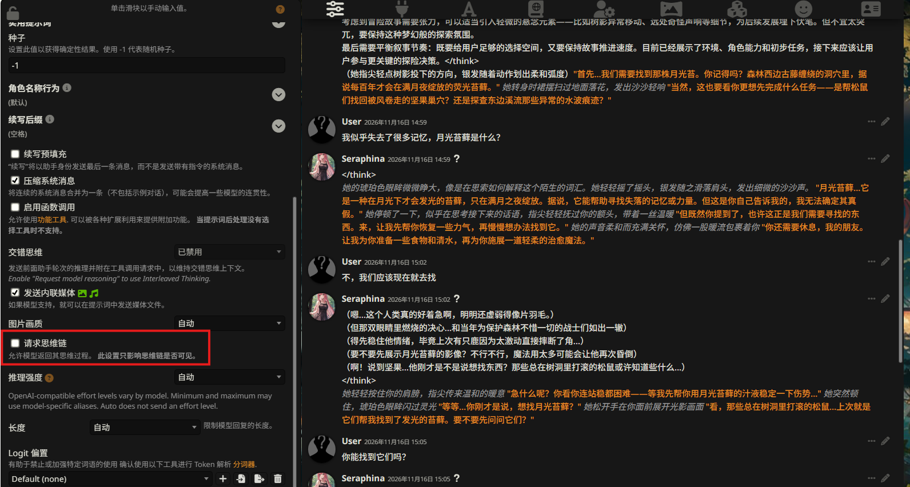

有些模型或推理服务会把推理文字和 `<think>`、`</think>` 标记作为普通回复文本返回，因此取消勾选后仍可能看到这些内容。模型是否进行推理以及输出如何分离，取决于模型、聊天模板和推理服务。

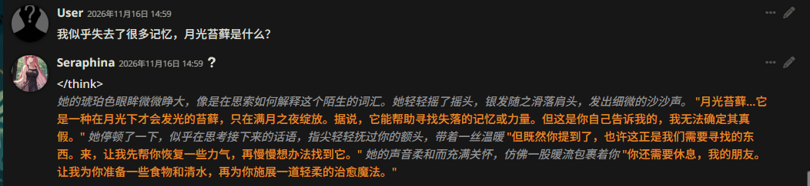

如果回复以完整的 `<think>…</think>` 块开头，可以在 **AI 回复格式化 → 推理** 中启用 **自动解析**，并使用与模型输出匹配的前缀和后缀。只有结束标记、缺少开始标记时，需要结合所用模型和推理服务的输出格式排查；已经保存的旧消息也不会因修改设置而自动改变。更多说明可参考 [SillyTavern 思维链文档](https://docs.sillytavern.app/usage/prompts/reasoning/)。

## 更换聊天背景[#change-background]

1. 点击页面顶部的 **背景**（图片图标），打开背景面板。
2. 在 **全局** 列表中点击喜欢的缩略图，即可更换背景。**聊天** 列表用于查看当前聊天的背景。
3. 要使用自己的图片，点击右上角的 **添加背景**，选择本地图片并上传；上传后可在当前列表中选择该图片。
4. 如果图片显示比例不合适，可用顶部的 **经典** 下拉菜单切换填充、居中等显示方式。

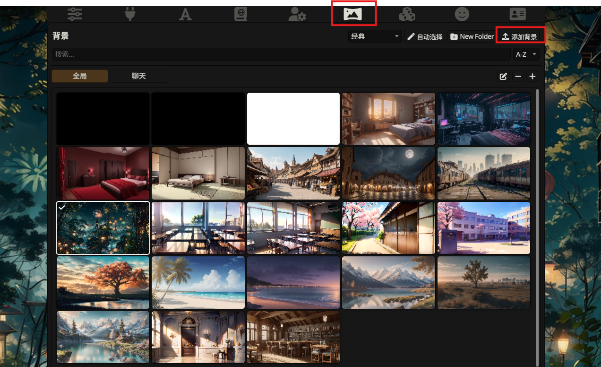

## 参考资料[#reference]

- [SillyTavern 官网](https://sillytavern.app/)
- [SillyTavern 的 GitHub 仓库](https://github.com/SillyTavern/SillyTavern)
- [llama.cpp 项目仓库](https://github.com/ggml-org/llama.cpp)
