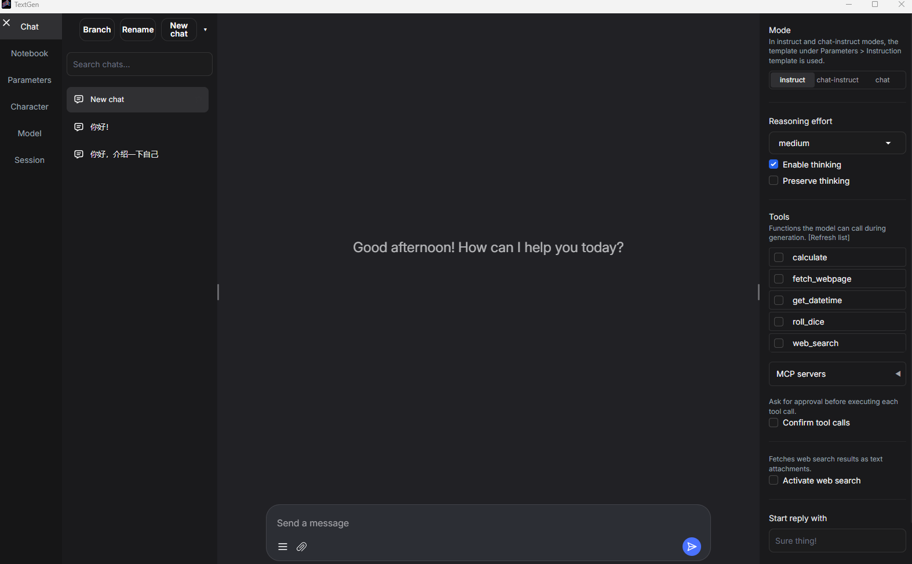
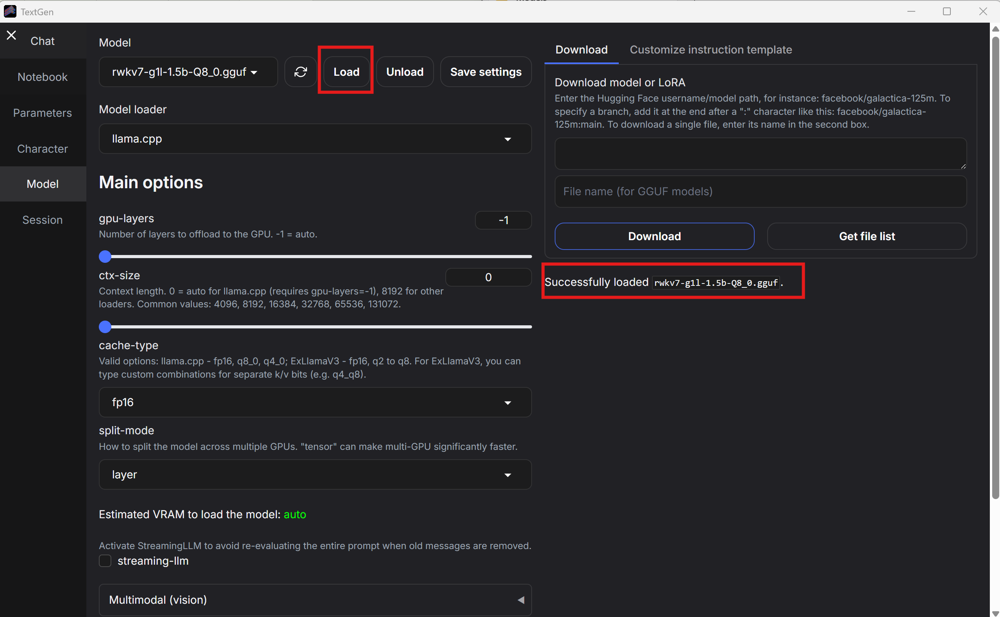
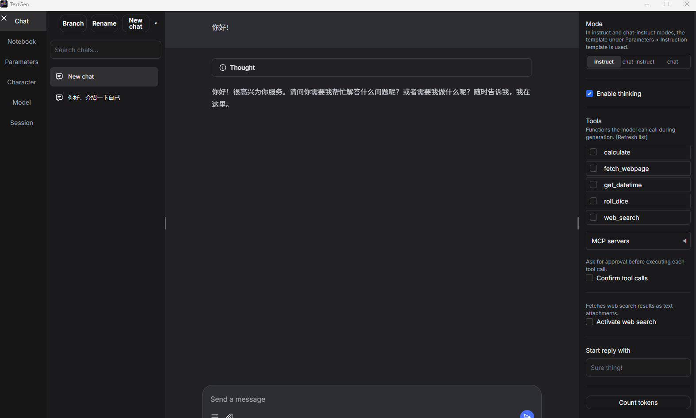
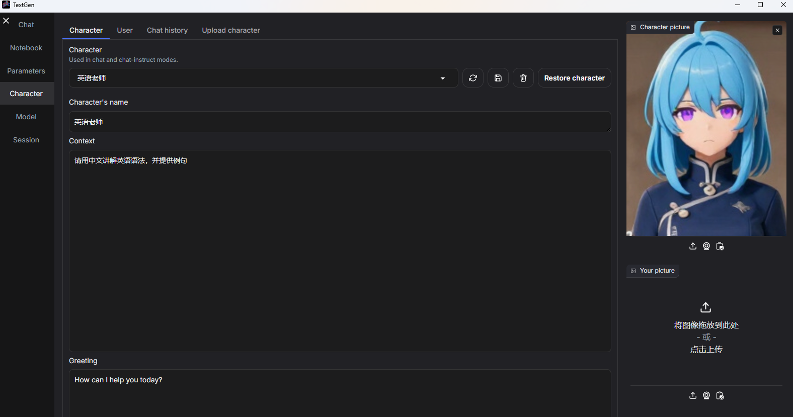
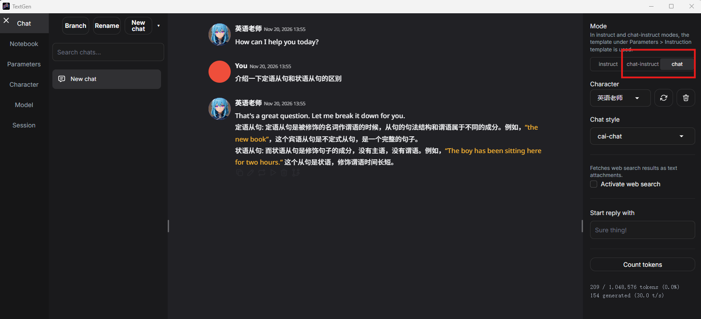
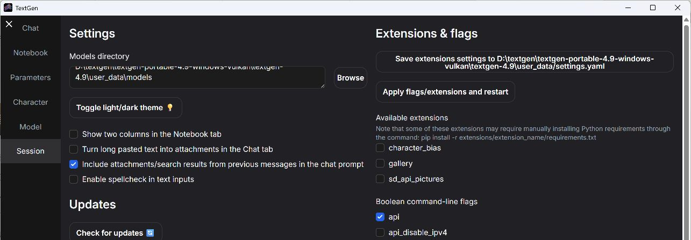

import { CallOut } from 'components-docs/call-out/call-out.tsx'

<CallOut type="info">
[TextGen](https://github.com/oobabooga/textgen)（原 Text Generation WebUI）是一个本地大语言模型桌面程序与 Web 界面，可以使用 llama.cpp 后端运行 RWKV GGUF 模型。
</CallOut>

本文介绍使用便携版运行 RWKV GGUF 的流程。需要训练、Transformers 或其他扩展时，再使用上游提供的完整安装方式。

## 下载并启动 TextGen

从 [TextGen Releases](https://github.com/oobabooga/textgen/releases) 下载适合当前系统和硬件的便携包。便携包已经包含 llama.cpp 和所需依赖。

| 设备 | 便携包选择 |
|------|------------|
| NVIDIA GPU | `nvidia-smi` 显示 CUDA 13.1 或更高版本时选择 CUDA 13.1，否则选择 CUDA 12.4 |
| AMD / Intel GPU | 优先选择 Vulkan |
| 支持 ROCm 7.2 的 AMD GPU | 也可以选择 ROCm |
| Apple Silicon | macOS arm64 |
| Intel Mac | macOS x86_64 |
| 仅使用 CPU | CPU-only |

下载完成后，将便携包解压到一个独立文件夹。

**macOS 用户还需要完成以下操作：** 首次启动前，在终端运行下面的命令，移除解压文件的隔离属性。请将路径替换成实际的 TextGen 文件夹：

```bash
xattr -cr /path/to/textgen-folder
```

完成上述准备后，根据系统启动 TextGen：

- **Windows：** 双击 `textgen.bat`
- **Linux 和 macOS：** 在解压目录中运行 `./textgen`

启动成功后，TextGen 会打开桌面界面。



如果希望改用浏览器界面，请从终端启动并添加 `--no-electron`：

- **Windows PowerShell：**`.\textgen.bat --no-electron`
- **Linux 和 macOS：**`./textgen --no-electron`

随后访问 `http://127.0.0.1:7860`。

<CallOut type="info">
如果需要训练、Transformers、ExLlamaV3 或其他扩展，请改用 [TextGen 完整安装说明](https://github.com/oobabooga/textgen#full-installation)。
</CallOut>

## 下载 RWKV 模型

TextGen 支持多种模型加载器，其中 llama.cpp 模型加载器支持 RWKV 模型。

llama.cpp 使用 `gguf` 格式的 RWKV 模型。可以从 [RWKV7-Gxx-GGUF 合集](https://huggingface.co/collections/shoumenchougou/rwkv7-gxx-gguf) 下载 RWKV-7 G 系列模型。

<CallOut type="tips">
自己微调了一个 RWKV-7 模型，想从 pth 转 gguf 格式？查看 [llama.cpp 文档 - 从 pth 模型转换为 gguf](../llamacpp#get-gguf-models)。
</CallOut>

<CallOut type="info">
同一个 RWKV 模型通常提供多种量化文件。第一次运行 G1l 1.5B 时，可以先选择 `Q5_K_M`。

- 内存或显存不足时，可以改用 `Q4_K_M`
- 内存或显存充足时，可以选择 `Q6_K`、`Q8_0` 或 FP16
- 0.1B 和 0.4B 模型优先选择 `Q8_0` 或 FP16
</CallOut>

等待模型下载完毕，将模型文件放到 TextGen 的 `user_data/models` 文件夹中：

```
textgen
└── user_data
    └── models
        └── rwkv7-g1l-1.5b-Q5_K_M.gguf
```

## 加载 RWKV 模型

回到 TextGen 界面，配置并加载 RWKV 模型：

1. 点击 `Model` 标签，切换到模型选择和配置页面
2. 点击 `Model` 下拉菜单，选择一个 RWKV 模型
3. 点击 `Model loader` 下拉菜单，选择 `llama.cpp` 作为模型加载器
4. 保持 GGUF 内置的聊天模板。只有自制 GGUF 缺少模板时，才需要手动配置指令模板
5. 点击 `Load` 按钮加载 RWKV 模型

<CallOut type="info">
如果 `Model` 下拉菜单未显示模型文件，可能是界面尚未同步 `user_data/models` 文件夹中的模型列表。

请**点击右侧的 🔄 刷新按钮**，更新模型列表。
</CallOut>

成功加载后，状态区域会显示 `Successfully loaded` 和当前模型名称。



## 开始聊天

模型加载完毕后，按照以下顺序开始对话：

1. 回到 `Chat` 页面
2. 选择 `instruct` 模式
3. 输入消息并点击 `Send`

界面中出现模型回复，即表示模型、加载器和聊天模板均可正常使用。



## 角色与对话记录

`Character` 页面用于设置对话角色、管理用户档案，以及导入和导出聊天记录。普通问答可以继续使用 `instruct` 模式；如果希望模型按照角色设定对话，可以按以下步骤操作：





1. 打开左侧 `Character` 页面，在顶部的 `Character` 标签中选择已有角色，或填写新的角色设定
2. 在 `Character's name` 中填写角色名称，在 `Context` 中描述角色的背景、回答方式等要求
3. 如需开场白，在 `Greeting` 中填写内容；新建对话时会显示这条消息
4. 点击角色下拉菜单旁的 💾 按钮，按照提示保存角色；右侧还可以上传角色头像和用户头像
5. 回到 `Chat` 页面，将 `Mode` 设为 `chat` 或 `chat-instruct`，然后开始对话

例如，可以将角色名称设为“英语老师”，在 `Context` 中填写“请用中文讲解英语语法，并提供例句”。角色设定会作为提示内容影响回复，实际效果取决于模型。

角色下拉菜单旁的刷新按钮可更新角色列表，`Restore character` 可恢复到上次保存的角色设定，🗑️ 按钮可删除选中的角色。

页面顶部还有以下标签：

| 标签 | 用途和操作 |
|------|------------|
| `User` | 设置用户名称和可选的个人描述；点击 💾 保存用户档案，也可以通过下拉菜单切换档案。 |
| `Chat history` | 点击 `Save history` 导出当前聊天记录；在 `Upload History JSON` 处导入记录时，会创建一条新对话。 |
| `Upload character` | 导入 YAML 或 JSON 格式的角色资料，或通过 `TavernAI PNG` 导入角色卡，选择文件后点击 `Submit`。 |

## 会话与程序设置

`Session` 页面用于调整 TextGen 的界面、扩展和启动选项。初次运行 RWKV 模型时，可以先保持默认设置。



- **Settings**：在桌面版中通过 `Models directory` 和 `Browse` 选择模型文件夹；也可以切换明暗主题、调整 Notebook 布局，以及设置聊天附件和拼写检查。
- **Updates**：点击 `Check for updates` 检查是否有新版本，并按页面提示访问下载地址。
- **Extensions & flags**：在 `Available extensions` 中选择扩展，在 `Boolean command-line flags` 中选择布尔启动选项。部分扩展可能需要额外安装依赖。

选择扩展后，可以点击 `Save extensions settings to .../settings.yaml` 保存扩展等界面设置，再点击 `Apply flags/extensions and restart` 重新加载界面并应用当前扩展和启动选项。

例如，`api` 用于启用 API，方便其他程序连接；`listen` 允许局域网访问界面，`share` 会创建公开访问链接。需要连接其他设备或分享服务时，再按实际需求配置这些选项。

## 其他参数说明

除了模型文件、`llama.cpp` 模型加载器和 GGUF 内置的聊天模板以外，TextGen 还提供一系列可调整的参数。这些参数会影响设备分配、上下文长度和生成速度。

通常可以**保持默认参数**运行模型。如需修改，请参考以下参数说明：

| 参数 | 什么时候调整 |
|------|--------------|
| `gpu-layers` | 分配到 GPU 的层数。`-1` 表示自动选择，`0` 表示只使用 CPU。通常保持 `-1`。 |
| `ctx-size` | 上下文长度。`gpu-layers` 为 `-1` 时可将其设为 `0`，让程序自动选择。 |
| `tensor_split` | 多 GPU 的显存分配比例，例如 `30,70`。单 GPU 不需要设置。 |
| `batch_size` / `ubatch_size` | 控制提示词处理批量。通常保持默认，只有在调优速度或解决显存不足时再修改。 |
| `threads` / `threads_batch` | CPU 线程数。通常分别使用物理核心数、逻辑核心数。 |
| `split-mode` | 多 GPU 切分方式。`tensor` 模式可能提高多卡速度。 |
| `no-mmap` / `mlock` / `numa` | 内存映射、锁页和多路 CPU 调优选项。没有明确问题时保持默认。 |
