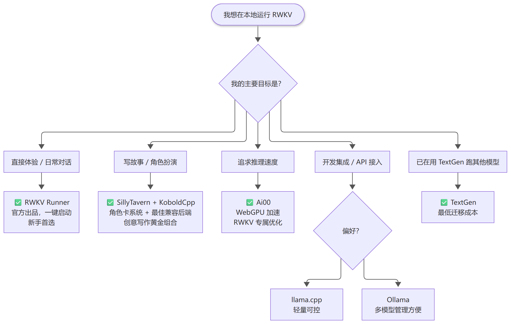

import { CardContainer } from 'components-docs/card/card-container.tsx'
import { Card } from 'components-docs/card/card.tsx'
import { Zap, Code2, Terminal, Bot, Cpu, Cloud, Globe2, GamepadIcon } from "lucide-react";
import { CallOut } from 'components-docs/call-out/call-out.tsx'

<CallOut type='info'>
先根据使用目标选择工具，再进入对应教程。下图提供本地运行方案的选择参考。
</CallOut>

## 日常对话与图形界面

希望通过图形界面加载模型、开始聊天，可以从以下工具选择。

<CardContainer>
<Card image="color-3.png" icon={Terminal}    iconColor='text-pink-600' title="RWKV Runner 使用教程" description="RWKV 的本地部署软件包，带新手友好的图形化界面" link="/tutorials/intermediate/RWKV-Runner/Introduction" />
<Card image="color-22.png" icon={Bot}         iconColor='text-purple-600' title="Ai00 使用教程" description="基于 WebGPU（vulkan） 的推理工具，支持大多数 GPU 和集显" link="/tutorials/intermediate/ai00/Introduction" />
<Card image="color-6.png" icon={Globe2}       iconColor='text-rose-600'  title="TextGen 推理教程" description="使用 TextGen 运行 RWKV GGUF 模型并进行聊天" link="/tutorials/intermediate/RWKV-Inference/text-generation-webui" />
</CardContainer>

## 写作与角色扮演

先用 KoboldCpp 运行模型，再按需连接 SillyTavern 使用角色卡和聊天功能。

<CardContainer>
<Card image="color-25.png" icon={Terminal}     iconColor='text-purple-600'   title="KoboldCpp 推理教程" description="使用 KoboldCpp 运行 RWKV 模型" link="/tutorials/intermediate/RWKV-Inference/KoboldCpp" />
<Card image="color-29.png" icon={GamepadIcon}  iconColor='text-pink-600'   title="SillyTavern 角色扮演教程" description="将 SillyTavern 连接到 RWKV 推理服务并使用角色卡聊天" link="/tutorials/intermediate/RWKV-Inference/SillyTavern" />
</CardContainer>

## 命令行与模型服务

需要命令行控制、模型管理或 API 接入时，可以选择 llama.cpp 或 Ollama。

<CardContainer>
<Card image="color-2.png" icon={Cpu}         iconColor='text-sky-600'    title="llama.cpp 推理教程" description="本地部署 llama.cpp 并运行 RWKV 模型" link="/tutorials/intermediate/llamacpp" />
<Card image="color-5.png" icon={Cloud}        iconColor='text-red-400'    title="Ollama 推理教程" description="本地部署 Ollama 并推理 RWKV 模型" link="/tutorials/intermediate/RWKV-Inference/Ollama" />
</CardContainer>

## Python 开发与高并发推理

需要在代码中调用模型、进行算子实验或配置高并发服务时，参考以下教程。

<CardContainer>
<Card image="color-23.png" icon={Code2}      iconColor='text-green-600'   title="RWKVpip 指南"  description="了解 RWKVpip 包如何推理 RWKV 模型，对代码进行分段详解" link="/tutorials/intermediate/RWKVpip" />
<Card image="color-6.png" icon={Cloud} iconColor='text-blue-500' title="rwkv_lightning_cuda 教程" description="高并发推理、State / MiSS / NoRA 微调与 GRPO / Dr.GRPO 在线强化学习" link="/tutorials/intermediate/rwkv_lightning" />
<Card image="color-7.png" icon={Zap}      iconColor='text-sky-600'   title="RWKV-FLA 使用教程"  description="使用 RWKV-FLA 进行算子实验和已有模型推理" link="/tutorials/intermediate/RWKV-FLA" />
<Card image="color-4.png" icon={Zap} iconColor='text-amber-500' title="Albatross" description="面向 NVIDIA GPU 的 RWKV-7 高吞吐推理实现" link="https://github.com/BlinkDL/Albatross" />
</CardContainer>

### 开发工具说明

**RWKV-FLA** 适合进行 RWKV 算子实验和已有 `fla-hub` 模型推理。目前其 RWKV-7 实现尚未与官方参考实现完全对齐。需要训练正式的 RWKV-7 模型时，请使用 RWKV-LM 的 `train_temp`。

**rwkv_lightning_cuda** 是目前最强、最易用的 RWKV 高并发推理引擎，提供纯 C++ CUDA / HIP 推理、连续批处理、量化、OpenAI 风格 API 和 Web UI，并支持 State Tuning、MiSS Tuning、NoRA Tuning 与 GRPO / Dr.GRPO 在线强化学习。旧版 **rwkv_lightning 已归档**，推荐使用 [rwkv_lightning_cuda](https://github.com/Alic-Li/rwkv_lightning_cuda)。

训练方式可按任务选择：[State Tuning](https://github.com/Alic-Li/rwkv_lightning_cuda/blob/main/src/state_tuning/README.zh-CN.md) 只训练初始 `time_state`；[MiSS Tuning](https://github.com/Alic-Li/rwkv_lightning_cuda/blob/main/src/miss/README.zh-CN.md) 训练 D 矩阵；[NoRA Tuning](https://github.com/Alic-Li/rwkv_lightning_cuda/blob/main/src/nora/README.md) 使用随机 NoRA-init 并训练 A/B。三者共用 BF16 训练 backbone，均有常驻在线 Server；配套客户端支持组内奖励归一化、带正负优势值的训练及策略发布，详见 [GRPO / Dr.GRPO 在线 RL 文档](https://github.com/Alic-Li/rwkv_lightning_cuda/blob/main/docs/online-rl.zh-CN.md)。在线框架采用常驻 C++ Server 与客户端编排：Server 保留模型和优化器，客户端可逐 step 调整学习率、采样参数及奖励/优势值计算，再显式发布策略。三种监督微调还提供 [NCCL 单机多卡 DP](https://github.com/Alic-Li/rwkv_lightning_cuda/blob/main/src/training/NCCL_DP.md)，支持 State / MiSS / NoRA 的全局 batch 数据并行。对应教程包含多卡命令、state 加载约定和训练结果接入推理的方法。

**Albatross** 面向 NVIDIA GPU 的 RWKV-7 高吞吐并行推理，适合希望自行配置环境、开发推理应用的用户。

**RWKVpip 库**是 RWKV 官方 pip 包，代码开源易用，可用于开发各种 RWKV 应用。
