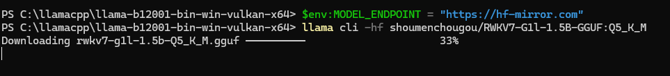
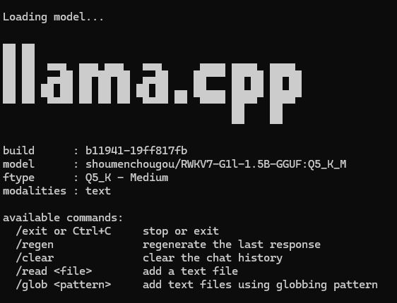
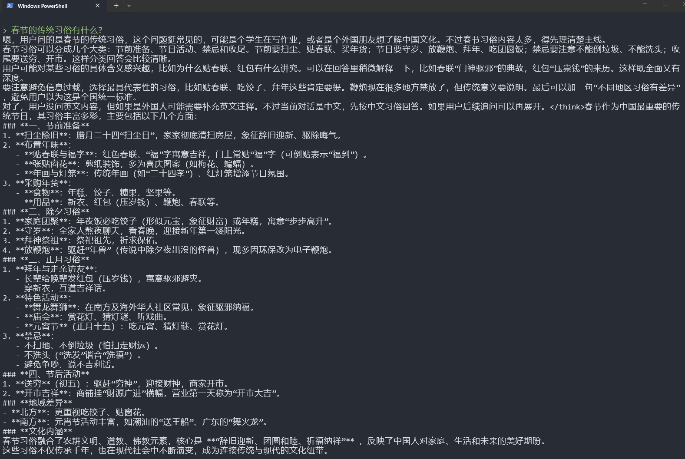
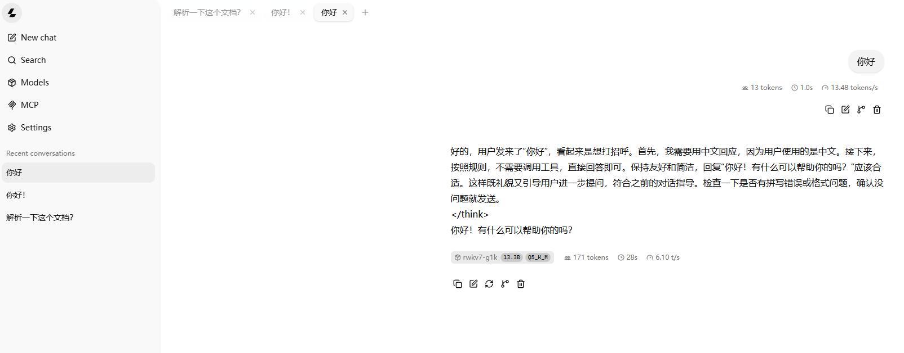
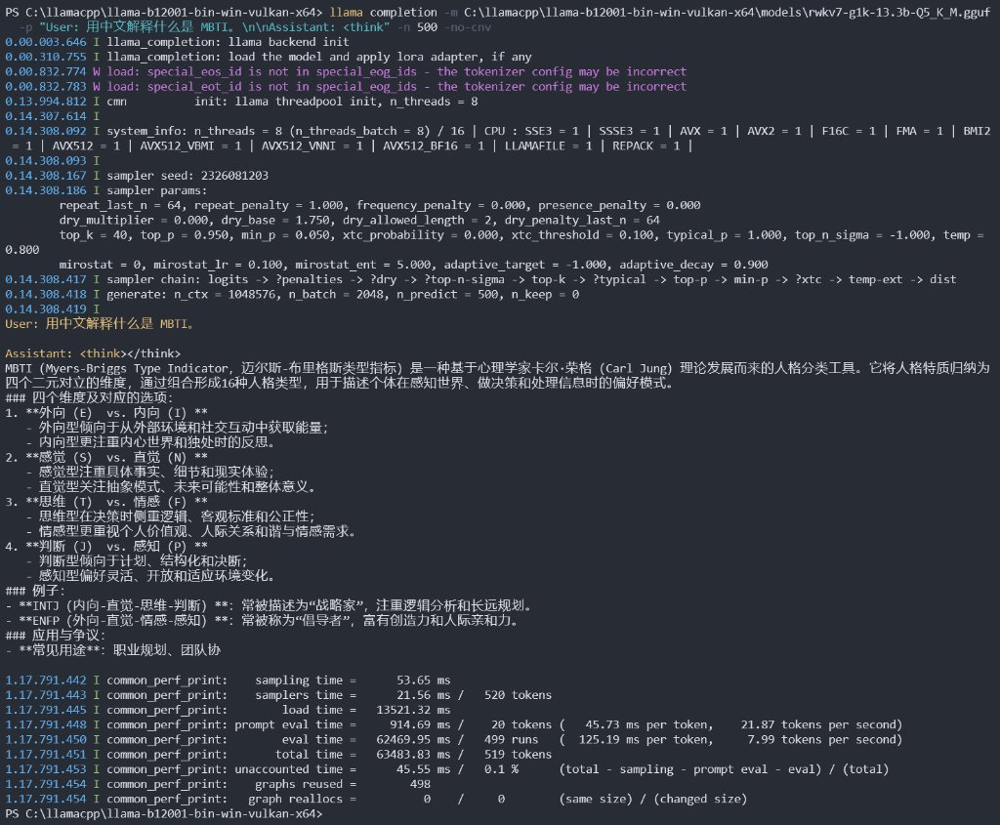
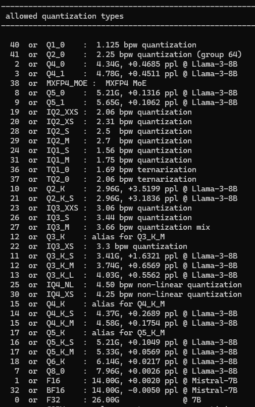

import { Tab, Tabs } from 'fumadocs-ui/components/tabs'
import { Step, Steps } from 'fumadocs-ui/components/steps'
import { CallOut } from 'components-docs/call-out/call-out.tsx'

<CallOut type="info">
[llama.cpp](https://github.com/ggml-org/llama.cpp) 是一个轻量化的大语言模型运行框架，支持在 CPU 和多种 GPU 后端上运行 GGUF 模型。
</CallOut>

llama.cpp 目前支持 RWKV-6 和 RWKV-7 的 GGUF 模型，RWKV 社区成员 [@MollySophia](https://github.com/MollySophia) 是相关适配的主要贡献者。

本章节介绍如何在 llama.cpp 中使用 RWKV 模型进行推理。

## 视频教程

<div className="iframe-container">
 <iframe 
 src="https://player.bilibili.com/player.html?isOutside=true&aid=113842906467984&bvid=BV1hgcdeqEW8&cid=27919253558&poster=1&p=0&high_quality=1&autoplay=0"
 scrolling="no"
 frameBorder="0"
 allowFullScreen={true}
 sandbox="allow-top-navigation allow-same-origin allow-forms allow-scripts"
>
</iframe>
</div>
<CallOut type="info">
高画质视频请[跳转到 B 站](https://www.bilibili.com/video/BV1hgcdeqEW8/)观看。
</CallOut>

## llama.cpp 推理 RWKV 模型

<CallOut type="info">
**先完成第 1 项，再在第 2、3 项中任选一种模型准备方式，最后进入第 4 项。**

- 推荐路线：**1 → 2 → 4**，由命令自动下载并缓存模型。
- 自定义路线：**1 → 3 → 4**，手动下载或转换模型，再指定本地文件运行。
</CallOut>

### 1. 获取 llama.cpp
 
如果只想尽快开始，推荐访问 [llama.app](https://llama.app/)，按照页面提示完成安装。如果需要自行选择运行后端或使用独立的命令行程序，再从 [llama.cpp 的 release 页面](https://github.com/ggml-org/llama.cpp/releases)下载已经编译好的程序。

打开 release 页面后，先根据下表选择适合当前设备的后端。压缩包名称可能随版本变化，不必寻找固定文件名。

| 设备 | 可选后端 |
|------|----------|
| NVIDIA GPU | CUDA |
| AMD GPU | ROCm / Vulkan |
| Intel GPU | SYCL / Vulkan / OpenVINO |
| Apple Silicon | Metal |
| 仅使用 CPU | CPU |

**Windows x64 + NVIDIA（CUDA）**：从同一个 Release 选择与 NVIDIA 驱动兼容的 CUDA 构建。例如 [b12001](https://github.com/ggml-org/llama.cpp/releases/tag/b12001) 提供 `llama-b12001-bin-win-cuda-12.4-x64.zip`。如果程序提示缺少 CUDA DLL，从同一发布页下载匹配的 `cudart-llama-bin-win-cuda-12.4-x64.zip`，将其中的 DLL 解压到 `llama-server.exe` 所在目录。

也可以参照 [llama.cpp 官方构建文档](https://github.com/ggml-org/llama.cpp/blob/master/docs/build.md)，选择适合的方法本地编译构建。

<CallOut type="info">
当前版本提供统一的 `llama` 命令。本页按下表调用不同功能：

| 功能 | 本页使用的命令 | 等价的独立程序 |
|------|----------------|----------------|
| 对话 | `llama cli` | `llama-cli` |
| Web 服务 | `llama serve` | `llama-server` |
| 原始文本续写 | `llama completion` | `llama-completion` |
| 模型量化 | `llama quantize` | `llama-quantize` |

使用 release 压缩包时，请先进入解压目录；自行编译时，请进入 `build/bin` 目录。Windows PowerShell 将表中的 `llama` 写成 `.\llama.exe`，例如 `.\llama.exe cli`；Linux 和 macOS 写成 `./llama`，例如 `./llama cli`。
</CallOut>

### 2. 由程序自动下载（推荐）[#auto-download]

在 llama.cpp 目录打开 PowerShell。如需使用镜像站，先运行：

```powershell
$env:MODEL_ENDPOINT = "https://hf-mirror.com"
```

这行命令将下载地址切换到镜像站。如果可以直接访问 Hugging Face，可以省略。第 4 项中选择自动下载的启动命令。

首次启动任一种界面时，程序都会自动下载并缓存模型。下图展示的是下载进度，请等待完成：



**设置完成后，直接前往[第 4 项：开始运行模型](#start-running)，无需执行第 3 项。**

### 3. 手动准备 GGUF 模型[#get-gguf-models]

通常用于自定义下载模型的配置，该方法没有前者便捷。

llama.cpp 使用 `.gguf` 格式的模型。运行当前公开模型时，建议直接下载已经转换好的 GGUF；如果需要运行自己的 `.pth` 模型或微调检查点，再手动转换格式。

#### 直接下载 GGUF 模型（推荐）[#download-gguf]

可以从 [RWKV7-Gxx-GGUF 合集](https://huggingface.co/collections/shoumenchougou/rwkv7-gxx-gguf) 下载当前的 RWKV-7 G 系列 GGUF 模型。

<CallOut type="info">
将下载或转换好的 GGUF 文件放入 llama.cpp 目录下的 `models` 文件夹，再在本项末尾设置文件路径。如果使用其他文件名或目录，请同步替换路径。
</CallOut>

<CallOut type="warning">
量化位数越低，模型占用通常越小，但生成质量也更容易受到影响。第一次下载时，可以按模型大小选择：

- 0.1B 和 0.4B：优先使用 FP16 或 `Q8_0`
- 1.5B 及以上：可以先使用 `Q5_K_M`。内存或显存充足时，再选择 `Q6_K`、`Q8_0` 或 FP16
</CallOut>

#### 从 pth 转换成 GGUF[#pth-to-gguf]

1. 首先，从 [Hugging Face](https://huggingface.co/BlinkDL) 或[魔搭平台](https://modelscope.cn/organization/RWKV?tab=model)（国内可访问）下载一个 `pth` 格式的 RWKV 模型
2. 从 [MollySophia/rwkv-mobile 仓库](https://github.com/MollySophia/rwkv-mobile/blob/master/converter/convert_rwkv_pth_to_gguf.py) 下载 RWKV 专用的社区转换脚本 `convert_rwkv_pth_to_gguf.py`
3. 下载 RWKV 分词表[rwkv_vocab_v20230424.txt](https://github.com/MollySophia/rwkv-mobile/blob/master/assets/rwkv_vocab_v20230424.txt)，确保分词器和转换脚本放在同一目录下
4. 运行 `python -m pip install torch gguf` 命令，安装转换脚本所需的依赖项
5. 在转换脚本目录下运行以下命令，将 `pth` 格式的模型转换为 `gguf` 格式的模型

```bash
python convert_rwkv_pth_to_gguf.py "你的模型.pth" "rwkv_vocab_v20230424.txt" --outfile "你的模型-FP16.gguf" --outtype f16
```

<CallOut type="warning">
请将 `你的模型.pth` 改成输入检查点的实际路径，将 `你的模型-FP16.gguf` 改成新的输出路径；路径含空格时保留双引号。生成的 FP16 GGUF 可直接加载，也可按下方步骤进一步量化。
</CallOut>

下载或转换完成后，记下模型的实际文件路径，在第 4 项选择本地模型的启动命令。路径中有空格时，请保留两侧的双引号。

**设置完成后，直接前往[第 4 项：开始运行模型](#start-running)，无需执行第 2 项。**

### 4. 开始运行模型[#start-running]

完成第 2 项或第 3 项后，在 llama.cpp 目录打开 PowerShell，选择一种对话方式，并运行与你的模型来源对应的命令。使用镜像时，需在当前窗口先设置上面的镜像地址。

显存充足用 `-ngl 99`，较少先试 `-ngl 20`；该参数控制 GPU 加载层数。

<Tabs items={['命令行对话', 'Web 网页（推荐）']} label="对话方式（二选一）">
<Tab value="命令行对话">
自动下载模型：

```powershell
llama cli -hf shoumenchougou/RWKV7-G1l-1.5B-GGUF:Q5_K_M
```

使用本地模型（请替换为实际路径）：

```powershell
llama cli -m ".\models\rwkv7-g1l-1.5b-Q5_K_M.gguf"
```


如果选择了第 2 项，首次启动会先下载模型，再自动加载。加载后，会显示模型名称、量化类型及可用命令：



在 `>` 提示符后输入问题并按 Enter，即可开始对话。模型生成结束后，可以继续输入下一个问题：



- `/exit` 或 Ctrl+C：退出程序。
- `/clear`：清空对话历史。
- `/regen`：重新生成上一条回复。

完整用法可以在 [llama.cpp 的命令行文档](https://github.com/ggml-org/llama.cpp/blob/master/tools/cli/README.md)中查看。

</Tab>
<Tab value="Web 网页（推荐）">
按模型来源选择一条命令，启动带浏览器界面的 Web 服务：

自动下载模型：

```powershell
llama serve -hf shoumenchougou/RWKV7-G1l-1.5B-GGUF:Q5_K_M --port 8080
```

使用本地模型（请替换为实际路径）：

```powershell
llama serve -m ".\models\rwkv7-g1l-1.5b-Q5_K_M.gguf" --port 8080
```

保持服务终端运行，等待模型加载完成后，打开 `http://127.0.0.1:8080`，即可访问 llama.cpp Web 页面并开始对话。



需要连接其他客户端时，请使用 OpenAI 兼容接口 `http://127.0.0.1:8080/v1/chat/completions`。停止 Web 服务时，在服务终端按 Ctrl+C。

</Tab>
</Tabs>


## 附加功能（可选）

### 启用续写模式

<CallOut type="info">
需要按完整 prompt 原样续写时，请使用 `llama completion`，并添加 `-no-cnv` 关闭聊天模板。否则，带聊天模板的模型会自动进入对话模式。
</CallOut>

```powershell
llama completion -m C:\llamacpp\llama-b12001-bin-win-vulkan-x64\models\rwkv7-g1k-13.3b-Q5_K_M.gguf -p "User: 用中文解释什么是 MBTI。\n\nAssistant: <think" -n 500 -no-cnv
```



- `-m`：指定本地 GGUF 模型路径，请替换成实际路径
- `-p`：将引号中的完整 prompt 原样交给模型续写
- `llama completion`：启动原始文本续写程序
- `-no-cnv`：关闭聊天模式，不使用模型内置模板补全 prompt
- 其他参数：与对话模式相同

示例末尾的 `Assistant: <think` 会让支持该格式的 RWKV 模型从思考模式开始生成。其他写法请参考 [RWKV 的提示词格式](../basic/Prompt-Format)。

### 量化 gguf 模型

使用 `llama quantize [input_model] [output_model] [quantization_type]`，可以对 FP32、BF16 或 FP16 的高精度 GGUF 模型进行量化，例如：

```bash
llama quantize models/input-FP16.gguf models/output-Q5_K_M.gguf Q5_K_M
```

请将示例中的输入、输出文件名替换成实际路径。

<CallOut type="warning">
输入文件应当是 FP32、BF16 或 FP16 模型。不要对已经量化的模型再次量化，这样做可能严重降低生成质量。
</CallOut>

使用 `llama quantize --help` 命令，查看当前版本支持的量化类型：



{/*
## 搭载 RWKV State 文件[#state-file]

<CallOut type="info">

State 是 RWKV 这类 RNN 模型特有的状态。通过搭载自定义的 State 文件，可以强化 RWKV 模型在不同任务上的表现。（类似于增强插件）

RWKV State 的介绍可参照 [State 文件介绍和用法](https://rwkv.cn/news/read?id=343)文章。
</CallOut>

遵循以下步骤，可在 llama.cpp 推理 RWKV 模型时搭载 State 文件：

<Steps>
### 下载 .pth 格式 State 文件

从以下链接下载 `.pth` 格式的 RWKV State 文件：

- [RWKV-6-World-v2.1/RWKV-6-ChnNovel 模型的 State 文件](https://hf-mirror.com/BlinkDL/temp-latest-training-models/tree/main/states)
- [RWKV-6-World-v3 模型的 State 文件](https://hf-mirror.com/BlinkDL/rwkv-6-misc/tree/main/states)

### 使用脚本转换 State 文件
 
由于 llama.cpp for RWKV 只接受 `.bin` 格式的 State 文件，因此我们需要使用附录中的 [convert_rwkv_state_to_llamacpp.py 脚本](#state-pthtobin)，将 `.pth` 格式的 State 文件转换为 `.bin` 格式。

在脚本目录，运行以下转换命令：

```bash copy
python convert_rwkv_state_to_llamacpp.py rwkv-x060-chn_single_round_qa-3B-20240516-ctx2048.pth rwkv-x060-chn_single_round_qa-3B-20240516-ctx2048-llamacpp.bin
```
参数解释：

- `rwkv-x060-chn_single_round_qa-3B-20240516-ctx2048.pth`：需要转换的 `.pth` State 文件路径
- `rwkv-x060-chn_single_round_qa-3B-20240516-ctx2048-llamacpp.bin`：转换后的 `.bin` State 文件路径

### 推理时搭载 State 文件

在 llama.cpp 推理 RWKV 模型时，添加额外的`-prompt-cache` 和 `--prompt-cache-ro` 参数，以搭载 RWKV State ：

``` bash copy
./llama-cli -m models/rwkv-6-world-7b-Q8_0.gguf -p "how can a pig fly?" -t 8 -ngl 99 -n 500 --prompt-cache rwkv-6-7b-v3-enQA-llamacpp.bin --prompt-cache-ro
```

参数解释：

- `--prompt-cache` ：加载 prompt cache 文件 ，填写 State 文件路径，如 `rwkv-x060-chn_single_round_qa-3B-20240516-ctx2048-llamacpp.bin`
- `--prompt-cache-ro` : 以只读方模式加载，生成时不要覆盖原 State 文件


</Steps>

## 附录代码[#appendix-code]

### `pth` 转 `gguf` 格式[#pthtogguf]


### `.pth` State 文件转成 `.bin`[#state-pthtobin]


以下代码可将 RWKV 官方发布的`.pth` State 文件，转换为 llama.cpp 可使用的 `.bin`格式 State 文件：

``` python copy filename="convert_rwkv_state_to_llamacpp.py"
import torch
import argparse
import struct
import array
from pathlib import Path


def convert_rwkv_state_to_llamacpp_cache(path_input, path_output):
    state = torch.load(path_input, map_location='cpu')
    n_head, head_size, _ = state['blocks.0.att.time_state'].shape
    n_embd = n_head * head_size
    n_layer = len(state.keys())
    print(f'n_layer: {n_layer}, n_embd: {n_embd}')
    
    LLAMA_SESSION_MAGIC = 0x6767736e
    LLAMA_SESSION_VERSION = 9

    with open(path_output, 'wb') as file:
        # magic, version, n_token_count
        file.write(struct.pack('3I', LLAMA_SESSION_MAGIC, LLAMA_SESSION_VERSION, 0))
        # model arch
        file.write(struct.pack('I5s', 5, b'rwkv6'))
        # session output ids, logits, embeddings (skip)
        file.write(struct.pack('=IQQ', 0, 0, 0))
        # cell_count, pos, n_seq_id, v_trans, n_layer
        file.write(struct.pack('=5I', 1, 0, 0, 0, n_layer))
        for _ in range(n_layer):
            # k_type = GGML_TYPE_F32, k_size = 2 * n_embd * sizeof(float)
            file.write(struct.pack('=iq', 0, 2 * n_embd * 4))
            for _ in range(2*n_embd):
                file.write(struct.pack('=f', 0.0))
            
        for i in range(n_layer):
            # v_type = GGML_TYPE_F32, v_size = n_head * head_size * head_size * sizeof(float)
            file.write(struct.pack('=iq', 0, n_head * head_size * head_size * 4))
            data = state[f'blocks.{i}.att.time_state'].float().transpose(1, 2).flatten().tolist()
            file.write(struct.pack(f'{n_head * head_size * head_size}f', *data))

def main():
    parser = argparse.ArgumentParser(description='Convert RWKV state to llama.cpp prompt cache')
    parser.add_argument('input', type=Path, help='Path to RWKV state')
    parser.add_argument('output', type=Path, help='File name for llama.cpp prompt cache')
    args = parser.parse_args()

    convert_rwkv_state_to_llamacpp_cache(args.input, args.output)

if __name__ == '__main__':
    main()
```
*/}
